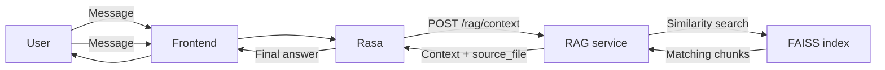

# 📘 langchain-rag-service

## 🧠 Overview
`langchain-rag-service` is a FastAPI microservice that retrieves relevant context from a Markdown knowledge base. It uses Sentence Transformers embeddings and a FAISS vector index, then returns the retrieved context and source filename to Rasa through `POST /rag/context`.

The RAG service retrieves information. Rasa uses that context as part of the chatbot response flow.

---

## ⭐ Architecture Role
Frontend → Rasa → RAG Retrieval Service → FAISS Vector Store
                           ↓
                    Retrieved context → Rasa

### 📊 Diagram



### 📌 Responsibilities
- Retrieve context from multiple documents for downstream reasoning
- Retrieve semantically relevant document chunks
- Filter retrieval by domain and grade metadata
- Build the FAISS index from Markdown files
- Return context and source filename to Rasa

---

## 🛠 Technology Stack

| Component           | Technology            |
|---------------------|-----------------------|
| API Framework       | FastAPI               |
| Retrieval Framework | LangChain             |
| Embeddings          | Sentence Transformers |
| Vector Store        | FAISS                 |
| Knowledge Base      | Markdown files        |
| Configuration       | Python and dotenv     |
| Containerization    | Docker                |

---

## ⚙️ Installation

### 1️⃣ Clone Repository

```bash
git clone <repository-url>
cd langchain-rag-service
```

### 2️⃣ Create Virtual Environment

```bash
python -m venv .venv
```

Activate it on Windows:

```powershell
.\.venv\Scripts\Activate.ps1
```

### 3️⃣ Install Dependencies

```bash
pip install -r requirements.txt
```

---

## 📈 Future Enhancements

Streaming context responses
Multi-language support
Knowledge admin interface
Hybrid search (keyword + vector)
Conversation memory
Source citation support
Caching layer (Redis)

---

## 🔐 Security

Protect API with authentication tokens
Validate user inputs
Implement rate limiting
Monitor prompt injection risks

## 🧪 Testing

You can test API using:
Swagger UI
Postman
curl

---

## 📜 License
This project is licensed under a Proprietary License:
You cannot use, copy, modify, merge, publish, distribute, sublicense, or sell copies of this Software or its parts outside the scope of internal enterprise use.

Contact [ESSID Saria] or the IT Department for special permissions.

---

## 🙏 Acknowledgments
Thanks to the IT and DEvops teams for the internal support.
Built with love by [ESSID Saria] 💻